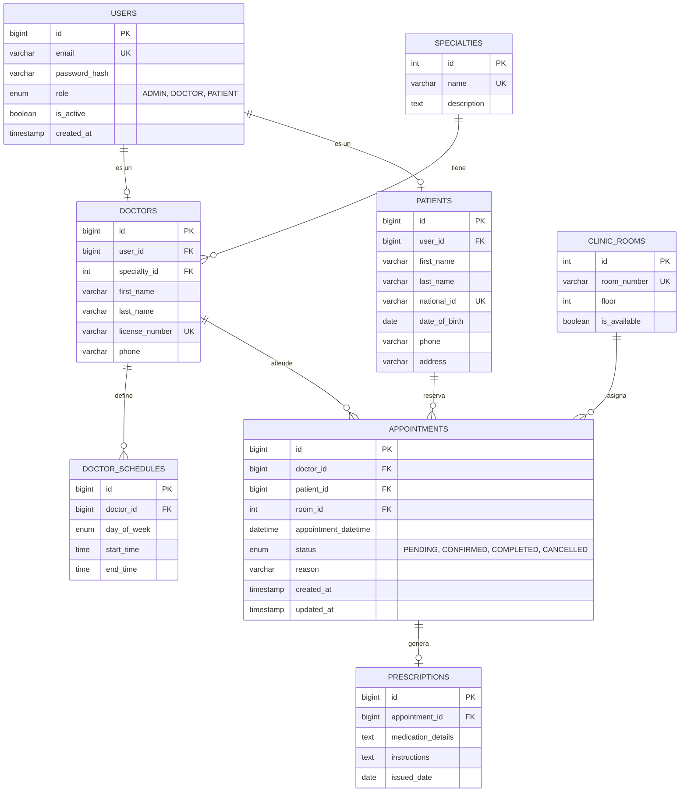

# Diseño de Base de Datos Relacional (MySQL) - Sistema de Gestión de Clínicas Inteligentes

Este documento detalla la arquitectura de datos relacional implementada en **MySQL** para gestionar las entidades transaccionales, usuarios, especialidades, horarios y citas médicas del **Sistema de Gestión de Clínicas Inteligentes**.

*(Nota: Los historiales clínicos no estructurados, notas médicas extensas y archivos adjuntos de diagnósticos se gestionan en una base de datos NoSQL complementaria vinculada mediante `patient_id` y `appointment_id`).*

---

## 📊 Diagrama Entidad-Relación (ERD)



---

## 🗂️ Diccionario de Tablas

1. **`users`**: Centraliza la autenticación y el control de acceso basado en roles (`ADMIN`, `DOCTOR`, `PATIENT`).
2. **`specialties`**: Catálogo normalizado de especialidades médicas (Cardiología, Pediatría, Dermatología, etc.).
3. **`doctors`**: Perfil profesional del médico vinculado a su cuenta de usuario y especialidad.
4. **`patients`**: Información demográfica y de identificación única de los pacientes.
5. **`clinic_rooms`**: Control de consultorios físicos disponibles en la clínica.
6. **`doctor_schedules`**: Franjas horarias recurrentes definidas por cada doctor para habilitar reservas.
7. **`appointments`**: Entidad transaccional principal que cruza médico, paciente, consultorio y fecha/hora.
8. **`prescriptions`**: Registro relacional de recetas médicas emitidas a partir de una cita completada.

---

## 🛠️ Script DDL (MySQL 8.0+)

```sql
CREATE DATABASE IF NOT EXISTS smart_clinic_db
CHARACTER SET utf8mb4
COLLATE utf8mb4_unicode_ci;

USE smart_clinic_db;

-- 1. Tabla de Usuarios (Autenticación y Roles)
CREATE TABLE users (
    id BIGINT AUTO_INCREMENT PRIMARY KEY,
    email VARCHAR(150) NOT NULL UNIQUE,
    password_hash VARCHAR(255) NOT NULL,
    role ENUM('ADMIN', 'DOCTOR', 'PATIENT') NOT NULL,
    is_active BOOLEAN NOT NULL DEFAULT TRUE,
    created_at TIMESTAMP DEFAULT CURRENT_TIMESTAMP,
    updated_at TIMESTAMP DEFAULT CURRENT_TIMESTAMP ON UPDATE CURRENT_TIMESTAMP
) ENGINE=InnoDB;

-- 2. Tabla de Especialidades Médicas
CREATE TABLE specialties (
    id INT AUTO_INCREMENT PRIMARY KEY,
    name VARCHAR(100) NOT NULL UNIQUE,
    description TEXT
) ENGINE=InnoDB;

-- 3. Tabla de Doctores
CREATE TABLE doctors (
    id BIGINT AUTO_INCREMENT PRIMARY KEY,
    user_id BIGINT NOT NULL UNIQUE,
    specialty_id INT NOT NULL,
    first_name VARCHAR(100) NOT NULL,
    last_name VARCHAR(100) NOT NULL,
    license_number VARCHAR(50) NOT NULL UNIQUE,
    phone VARCHAR(20),
    CONSTRAINT fk_doctor_user FOREIGN KEY (user_id) REFERENCES users(id) ON DELETE CASCADE,
    CONSTRAINT fk_doctor_specialty FOREIGN KEY (specialty_id) REFERENCES specialties(id) ON DELETE RESTRICT
) ENGINE=InnoDB;

-- 4. Tabla de Pacientes
CREATE TABLE patients (
    id BIGINT AUTO_INCREMENT PRIMARY KEY,
    user_id BIGINT NOT NULL UNIQUE,
    first_name VARCHAR(100) NOT NULL,
    last_name VARCHAR(100) NOT NULL,
    national_id VARCHAR(30) NOT NULL UNIQUE,
    date_of_birth DATE NOT NULL,
    phone VARCHAR(20) NOT NULL,
    address VARCHAR(255),
    CONSTRAINT fk_patient_user FOREIGN KEY (user_id) REFERENCES users(id) ON DELETE CASCADE
) ENGINE=InnoDB;

-- 5. Tabla de Consultorios
CREATE TABLE clinic_rooms (
    id INT AUTO_INCREMENT PRIMARY KEY,
    room_number VARCHAR(20) NOT NULL UNIQUE,
    floor INT NOT NULL,
    is_available BOOLEAN NOT NULL DEFAULT TRUE
) ENGINE=InnoDB;

-- 6. Tabla de Disponibilidad Horaria de Doctores
CREATE TABLE doctor_schedules (
    id BIGINT AUTO_INCREMENT PRIMARY KEY,
    doctor_id BIGINT NOT NULL,
    day_of_week ENUM('MONDAY', 'TUESDAY', 'WEDNESDAY', 'THURSDAY', 'FRIDAY', 'SATURDAY', 'SUNDAY') NOT NULL,
    start_time TIME NOT NULL,
    end_time TIME NOT NULL,
    CONSTRAINT fk_schedule_doctor FOREIGN KEY (doctor_id) REFERENCES doctors(id) ON DELETE CASCADE,
    CONSTRAINT chk_valid_time_range CHECK (start_time < end_time)
) ENGINE=InnoDB;

-- 7. Tabla de Citas Médicas
CREATE TABLE appointments (
    id BIGINT AUTO_INCREMENT PRIMARY KEY,
    doctor_id BIGINT NOT NULL,
    patient_id BIGINT NOT NULL,
    room_id INT,
    appointment_datetime DATETIME NOT NULL,
    status ENUM('PENDING', 'CONFIRMED', 'COMPLETED', 'CANCELLED') NOT NULL DEFAULT 'PENDING',
    reason VARCHAR(255) NOT NULL,
    created_at TIMESTAMP DEFAULT CURRENT_TIMESTAMP,
    updated_at TIMESTAMP DEFAULT CURRENT_TIMESTAMP ON UPDATE CURRENT_TIMESTAMP,
    CONSTRAINT fk_appointment_doctor FOREIGN KEY (doctor_id) REFERENCES doctors(id) ON DELETE RESTRICT,
    CONSTRAINT fk_appointment_patient FOREIGN KEY (patient_id) REFERENCES patients(id) ON DELETE RESTRICT,
    CONSTRAINT fk_appointment_room FOREIGN KEY (room_id) REFERENCES clinic_rooms(id) ON DELETE SET NULL,
    -- Evita doble reserva exacta para el mismo doctor a la misma hora
    CONSTRAINT uq_doctor_appointment_time UNIQUE (doctor_id, appointment_datetime)
) ENGINE=InnoDB;

-- 8. Tabla de Recetas Médicas
CREATE TABLE prescriptions (
    id BIGINT AUTO_INCREMENT PRIMARY KEY,
    appointment_id BIGINT NOT NULL UNIQUE,
    medication_details TEXT NOT NULL,
    instructions TEXT NOT NULL,
    issued_date DATE NOT NULL,
    CONSTRAINT fk_prescription_appointment FOREIGN KEY (appointment_id) REFERENCES appointments(id) ON DELETE CASCADE
) ENGINE=InnoDB;

-- Índices para optimización de consultas frecuentes
CREATE INDEX idx_appointments_datetime ON appointments(appointment_datetime);
CREATE INDEX idx_appointments_status ON appointments(status);
CREATE INDEX idx_doctors_specialty ON doctors(specialty_id);
```

---

## ⚙️ Procedimientos Almacenados para Reportes

Para cumplir con los requerimientos analíticos del panel de Administración (`HU-ADM-03`), se implementaron procedimientos almacenados optimizados:

### Reporte de Citas y Tasa de Cancelación por Especialidad

```sql
DELIMITER //

CREATE PROCEDURE sp_GetSpecialtyAppointmentReport(
    IN p_start_date DATE,
    IN p_end_date DATE
)
BEGIN
    SELECT 
        s.name AS specialty_name,
        COUNT(a.id) AS total_appointments,
        SUM(CASE WHEN a.status = 'COMPLETED' THEN 1 ELSE 0 END) AS completed_appointments,
        SUM(CASE WHEN a.status = 'CANCELLED' THEN 1 ELSE 0 END) AS cancelled_appointments,
        ROUND(
            (SUM(CASE WHEN a.status = 'CANCELLED' THEN 1 ELSE 0 END) / NULLIF(COUNT(a.id), 0)) * 100, 
            2
        ) AS cancellation_rate_percentage
    FROM specialties s
    LEFT JOIN doctors d ON s.id = d.specialty_id
    LEFT JOIN appointments a ON d.id = a.doctor_id 
        AND DATE(a.appointment_datetime) BETWEEN p_start_date AND p_end_date
    GROUP BY s.id, s.name
    ORDER BY total_appointments DESC;
END //

DELIMITER ;
```

---

## 🔒 Integridad y Validaciones Clave

* **Prevención de Conflictos:** La restricción `UNIQUE (doctor_id, appointment_datetime)` en `appointments` garantiza a nivel de motor de base de datos que un médico no pueda tener dos citas simultáneas.
* **Borrado Seguro:** Se utiliza `ON DELETE RESTRICT` en relaciones críticas (`doctors` y `patients` hacia `appointments`) para evitar la pérdida accidental de registros históricos médicos.
* **Compatibilidad con JPA/Hibernate:** Los tipos de datos (`BIGINT`, `VARCHAR`, `DATETIME`, `ENUM`) y convenciones de nombres (`snake_case`) están mapeados directamente con las anotaciones `@Entity`, `@Table`, `@OneToMany` y `@ManyToOne` en Spring Boot.